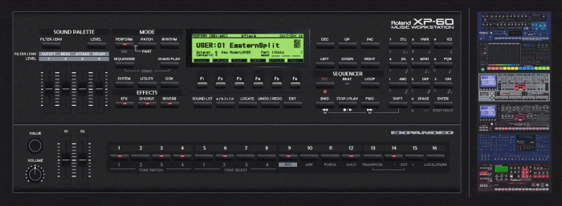

# Roland Synth Skins

I came across a mock-ups of a Roland JP-8080 synth as a Roland Boutique. Whoever made it used blender and put in a great effort to make it look really good, lighting and all. This inspired me to make my own, except, I don't know blender, only Rainmeter and Paintdotnet. Sooo... Here's my valiant efforts at making some old classic synths into modern Roland Boutiques, after 3 months work and a little help from the forum! :thumbup:

These aren't really of any use other than a little fun to mess around with and maybe for users to get some ideas. I will release some components from these skins in a separate thread as these may actually be of some use to someone.

Downloads: I had to split each synth to a separate skin package due to forum upload size limits. Each package is complete in and of itself, though each contains duplicates. Each package contains a Common.inc file and two directories: ~Resources and Previews. Installing each package should in theory install to the same skin Config folder named Synths and overwrite the files that were already there should these be duplicates. Any issues, just ask. Enjoy! :D

