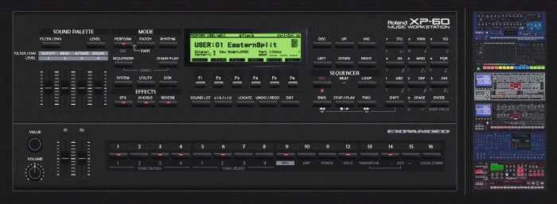
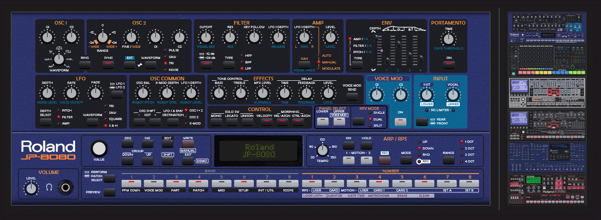
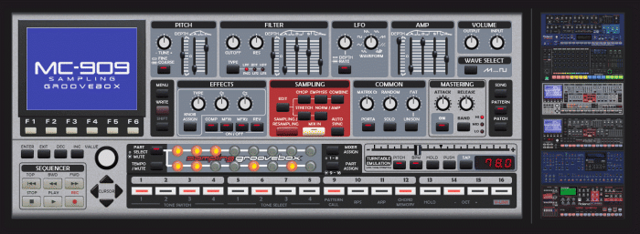
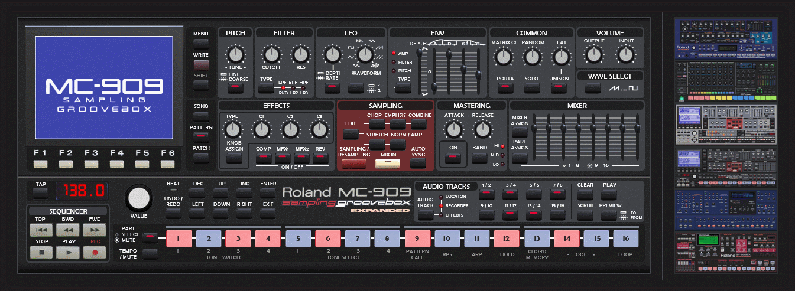
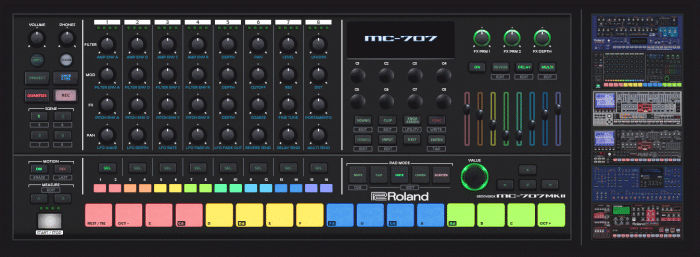
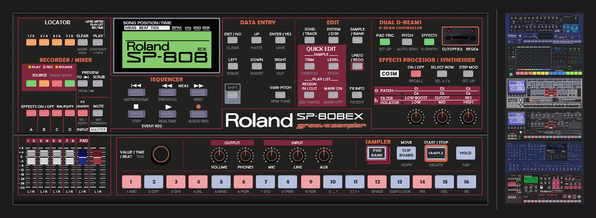
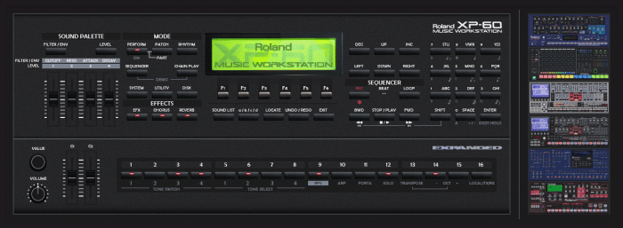
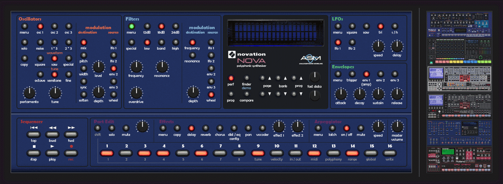

# Roland Synth Rainmeter Skins

I came across a mock-ups of a Roland JP-8080 synth as a Roland Boutique. Whoever made it used blender and put in a great effort to make it look really good, lighting and all. This inspired me to make my own, except, I don't know blender, only Rainmeter and Paintdotnet. Sooo... Here's my valiant efforts at making some old classic synths into modern Roland Boutiques, after 3 months work and a little help from the forum!

These aren't really of any use other than a little fun to mess around with and maybe for users to get some ideas. I will release some components from these skins in a [separate thread](https://forum.rainmeter.net/viewtopic.php?t=45748) as these may actually be of some use to someone.

Downloads: I had to split each synth to a separate skin package due to forum upload size limits. Each package is complete in and of itself, though each contains duplicates. Each package contains a Common.inc file and two directories: ~Resources and Previews. Installing each package should in theory install to the same skin Config folder named Synths and overwrite the files that were already there should these be duplicates. Any issues, just ask. Enjoy! :D

| First, here's a preview of the full package in action: |
|---|
|  |

| JP-8080 Boutique |
|---|
|  |
| Much as the original with a couple of design tweaks, like a knob for the Osc 1 Waveform selector as it is far easier and quicker in real life than clicking a button to change between 7 waveforms.  |

| MC-909 Boutique |
|---|
|  |
| One of my favourite pieces of hardware! This was so easy to use and far superior to the MC-707 in terms of workflow for programming sounds and a far better sequencer. I would like to see this Boutique version released, but with these additions:
| 1. All SRX boards waveforms and patches included by default.
| 2. Add a Loop function to the sequencer, same as the Loop button function on the XP-60. This then allows easier editing when creating long patterns. Remember, this thing could create patterns up to 999 measures long! So having a Loop function to repeat a small section would make life so much easier here.
| 3. Same FX, but add more options.
| Only issue with this as a Boutique is that there's no room for the Mixer section... which is why I redesigned it again with more mods and called it the MC-909ex, next...  |

| MC-909ex Boutique |
|---|
|  |
| Ok, so this time, I made many changes and would like to see the inclusion of the above features added, but also these:
| 1. Remove the Turntable emulation. Personally not into that!
| 2. Merged the envelopes with a selector button to switch between them.
| 3. Added button to the LFO section to enable more editing. This allows front panel control and editing of LFO 2, something not on the original.
| 4. Added extra FX knob for more performance and recording motion control.
| 5. Added a mixer section and buttons for switching between parts and Mixer Assign.
| 6. Would like this model to include the FX from the SP-808.
| 7. Added buttons to allow Audio Tracks from the SP-808 to be added to the front panel and recorded to in the same way as a real SP-808, but with it's full functionality, not half baked like on Fantom. Anyone who's used the SP-808 will know exactly what I mean here!
| 8. Added a front panel flashing led for BEAT to see the tempo flashing away to allow easier timing when recording. Something poorly done on MC-707. There's no "first beat" on the 707!
| 9. Rearranged the Cursor buttons as this is a far easier to use placement than the original hardware.  |

| MC-707 Boutique |
|---|
|  |
| I've added some extra knobs and buttons here:
| 1. Added a very much needed KnobCtrl button to allow all those front panel knobs to be used as either mixer channel knobs, as per the original hardware, or switch them to allow programming of the synth parts in easy mode, or partials in pro mode.
| 2. Added a fourth row of knobs seeing as the original hardware was designed for having four knobs but physically only has three per channel.
| 3. Again, as the original only gives four knobs under the screen area, I increased this to eight to allow more direct control without need to keep switching.
| 4. Added an extra FX parameter knob for more FX control.
| 5. Mixer size is reduced but even at this size should still be as useful.  |

| SP-808 Boutique |
|---|
|  |
| Obviously, the original format needed a lot of redesign here, but I tried to keep to the originals aesthetic, much as I could.  |

| XP-60 Boutique |
|---|
|  |
| Keeping with the original design again, this is essentially an XP-60 module, ie an XP-60 without the keyboard. But again, It would be nice to have more FX capabilities, and include all SR-JV boards that were released, meaning this should come with every waveform and patch released on all of the SR-JV expansion boards. Keeping the sequencer intact is also a necessity here. This was my first and I found this so easy to use compared to most of the stuff released today!
There are likely other improvements that could/should be made, but I would be happy if they released this with my FR's!  |

| Nova Boutique |
|---|
|  |
| And here's an old non-Roland classic I owned that was a true innovation in it's day!  |
